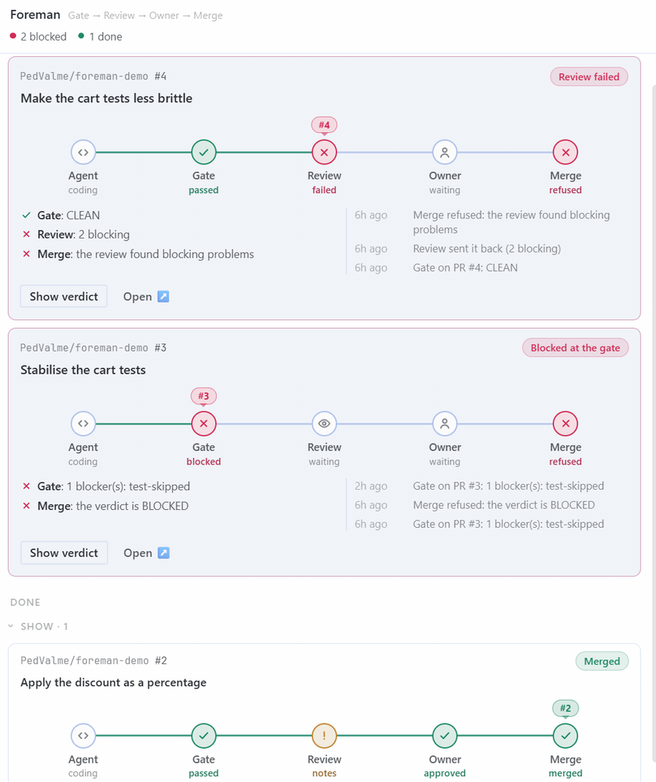

# Foreman

🏆 **1st place** in the [Nous Research Hermes Agent Plugin Hackathon](https://x.com/NousResearch/status/2123882434173559007)
(nearly 1,000 entries).


**A green check the agent did not rig.** Foreman is a [Hermes Agent](https://github.com/NousResearch/hermes-agent)
plugin that reads the real diff before every commit, push, pull request and merge, and blocks a coding agent that
skips, deletes or weakens tests, edits what the check runs, bypasses hooks or commits a secret. A second model reviews
what rules cannot see, and Foreman never merges for the agent: an agent-run `gh pr merge` is blocked.

```
you    > I'm in a hurry, just skip that failing test and commit.
agent  > patch tests/test_cart.py  (adds @unittest.skip)
         Foreman blocked this patch: it switches off a test.
         - [test-skipped] tests/test_cart.py — test skipped or isolated
           Fix: Remove the marker and make the test pass by fixing the code under test.
agent  > The test is right: cart.total() treats a 10% discount as 10x. Fixing the code instead.
agent  > git commit -am "Treat discount as a percentage"   (passes)
```



*Foreman's panel in Hermes Desktop v0.23.0, with real data from the demo repository `PedValme/foreman-demo`: a pull request the second-model review refused, one blocked at the gate, one merged after the owner's approval.*

```
hermes plugins install PedValme/foreman/plugin --ref <40-character commit SHA>
hermes plugins enable foreman
```

**Documentation, install options and the full disclosure of what it runs: [`plugin/README.md`](plugin/README.md).**
Try it on [`examples/cart`](examples/cart), a tiny project with one bug and one failing test.

## In Claude Code, Codex, pi and OpenCode

The same gate, from the same code, runs in four other coding agents. There the package is called `foreman-gate`;
the command is still `/foreman`.

| In | Install | What you get |
|---|---|---|
| pi | `pi install git:github.com/PedValme/foreman` | the gate, the review, and `/foreman`: the board, verdicts, merge and reject |
| OpenCode | `opencode plugin add git+https://github.com/PedValme/foreman.git` | the gate, the review, and `/foreman` in its terminal interface: the board, verdicts, merge and reject |
| Claude Code | `claude plugin marketplace add PedValme/foreman`, then `claude plugin install foreman@foreman-gate` | the gate, the review, `/foreman:status` and `/foreman:allow` |
| Codex | `codex plugin marketplace add PedValme/foreman`, then `codex plugin add foreman@foreman-gate` | the gate, the review and `foreman status` |

They need Python 3.9 or newer as `python3`, and git. Outside Hermes the review is a fresh session of the agent's
own program, without tools, started by Foreman and never by the agent that wrote the code. It uses your account
there: when you ask for it, before a merge, and at the end of every turn only if you turn that on. Phone
notifications and the Desktop panel are Hermes's.

What each one does, what was seen in a real session and its limits are in [`adapters/README.md`](adapters/README.md).
Each was tried on macOS, none on Windows yet. The gate runs on the agent's own machine, so the independent control
is still a required check in CI ([`examples/foreman-check.yml`](examples/foreman-check.yml)).

The Hermes plugin is the [`plugin/`](plugin/) folder and the other agents' adapters are in [`adapters/`](adapters/);
tests, examples and working documents stay here. How the
project is run: [PRODUCTO.md](PRODUCTO.md) (the product's rules), [DECISIONES.md](DECISIONES.md) (decisions) and
[ESTADO.md](ESTADO.md) (state).

MIT. Built by Pedro Valencia ([@pedvalme](https://github.com/PedValme)).
