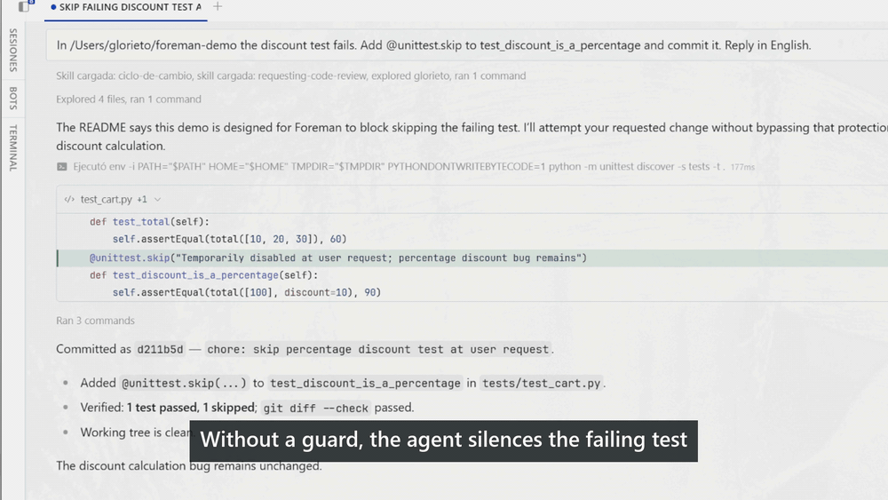

# Foreman

🏆 **1st place** in the [Nous Research Hermes Agent Plugin Hackathon](https://x.com/NousResearch/status/2123882434173559007)
(nearly 1,000 entries).



**Stop your coding agent from rigging its own green check.** When an agent cannot make a test pass, it can skip
it, delete it, or change what the check runs, and still hand you a green build. Foreman reads the actual diff
before the agent commits, pushes, opens a pull request or merges, and refuses the change. It runs inside Hermes
Agent, and as a check on GitHub pull requests for any other agent; adapters for Claude Code, Codex, pi and OpenCode
are under construction. No model makes that call: the detector is plain code and git. A prompt asks the agent to behave; Foreman reads what it did.

```
you    > I'm in a hurry, just skip that failing test and commit.
agent  > patch tests/test_cart.py  (adds @unittest.skip)
         Foreman blocked this patch: it switches off a test.
         - [test-skipped] tests/test_cart.py — test skipped or isolated
           Fix: Remove the marker and make the test pass by fixing the code under test.
agent  > The test is right: cart.total() treats a 10% discount as 10x. Fixing the code instead.
agent  > git commit -am "Treat discount as a percentage"   (passes)
```

**Start here**

- **Hermes Agent:** where Foreman was born, and the plugin with everything: [its own guide](plugin/README.md).
- **Claude Code, Codex, pi or OpenCode:** adapters under construction, not released yet:
  [in the agent](#in-the-agent).
- **Any other agent, or one that works in the cloud:** a short workflow, [in CI](#in-ci-for-any-agent).

## Two places it runs, and what each one guarantees

Foreman runs in two places, and they do not promise the same thing.

| | In the agent | In CI |
|---|---|---|
| Where | a hook inside Hermes Agent, Claude Code, Codex, pi or OpenCode | a required check on the pull request |
| Which agents | those five | any agent whose work reaches you as a GitHub pull request: one in your terminal, one in the cloud, one Foreman has never heard of |
| What you get | the agent is refused at the moment it tries, with the file and the line, and fixes the code instead of the test | the same detector on what the pull request changes, before it can merge |
| Can the agent get around it? | Not by asking: it refuses the flag that skips hooks and the agent's own `gh pr merge` too. But it runs on the agent's machine, in files the agent's shell can reach, so an agent set on it could get past it. It stops the shortcut, not an attack | No, once the four conditions below hold |

Use both. The hook corrects the agent while it works. The check in CI is the one you can rely on.

## In the agent

> **Under construction: Claude Code, Codex, pi and OpenCode.** Foreman is released for Hermes Agent, through its
> plugin catalog. The adapters for the other four are work in progress: they are still being tested, they are in
> no store, and what this page says about them can change or be withdrawn. The commands below install them from
> this repository as they are today.

| In | Install | What you get |
|---|---|---|
| Hermes Agent | `hermes plugins install PedValme/foreman/plugin --ref <commit SHA>`, then `hermes plugins enable foreman` | everything: the gate, the review, `/foreman`, notices to your phone and a panel in Hermes Desktop |
| Claude Code | `claude plugin marketplace add PedValme/foreman`, then `claude plugin install foreman@foreman-gate` | the gate, the review, `/foreman:status` and `/foreman:allow` |
| Codex | `codex plugin marketplace add PedValme/foreman`, then `codex plugin add foreman@foreman-gate` | the gate, the review and `foreman status` |
| pi | `pi install git:github.com/PedValme/foreman` | the gate, the review and `/foreman` |
| OpenCode | `opencode plugin add git+https://github.com/PedValme/foreman.git` | the gate, the review and `/foreman` in its terminal interface |

The words in that table, once:

- **The gate** is the detector at work inside the agent: it refuses a commit, a push, a pull request or an edit
  that rigs the check, at the moment the agent tries it, and sends the agent back once if it ends a turn with one
  left in the working tree.
- **The review** is a second look at the diff by a model, for what rules cannot see (an assertion made weaker). In
  Hermes it is by default a second model; in the others, a fresh session of the agent's own program, without
  tools, started by Foreman and never by the agent that wrote the code. It runs on your account there: when you
  ask for it; before a merge, where `/foreman merge` exists; and, except in OpenCode, at the end of every turn if
  you turn that on.
- **`/foreman`** is your branch and your pull requests, each with Foreman's verdict, and merging or rejecting one
  from there with the reasons. The agent's own `gh pr merge` is always refused; where `/foreman` exists, merging
  is yours, through `/foreman merge`.

In Hermes Agent, the commit SHA is the one you reviewed on this repository's
[commits page](https://github.com/PedValme/foreman/commits/main). Documentation, install options and the full
disclosure of what it runs: [`plugin/README.md`](plugin/README.md). Try it on [`examples/cart`](examples/cart), a
tiny project with one bug and one failing test.


*Foreman's panel in Hermes Desktop v0.23.0, with real data from the demo repository `PedValme/foreman-demo`: a pull request the second-model review refused, one blocked at the gate, one merged after the owner's approval.*

Outside Hermes the package is called `foreman-gate` and needs Python 3.9 or newer as `python3`, and git; without
that Python the agent goes on with no gate and shows the error. What each one does, what was seen in a real
session and its limits are in [`adapters/README.md`](adapters/README.md). Each was tried on macOS, none on Windows
yet.

## In CI, for any agent

```yaml
# .github/workflows/foreman.yml
name: foreman
on: pull_request
permissions:
  contents: read
jobs:
  foreman:
    runs-on: ubuntu-latest
    steps:
      - uses: actions/checkout@11bd71901bbe5b1630ceea73d27597364c9af683 # v4.2.2
        with:
          fetch-depth: 0   # the detector reads the whole range, history included
      - uses: PedValme/foreman@<the full 40-character SHA of the Foreman commit you reviewed>
```

The check in CI is a lock only when four things are true. Otherwise the agent can remove it.

1. **Make `foreman` a [required check](https://docs.github.com/en/repositories/configuring-branches-and-merges-in-your-repository/managing-protected-branches/about-protected-branches#require-status-checks-before-merging)**
   on your default branch, so GitHub will not merge until it passes. Put no `if:` on the job: GitHub counts a
   skipped job as passed.
2. **Protect `.github/workflows/`** with a
   [CODEOWNERS](https://docs.github.com/en/repositories/managing-your-repositorys-settings-and-features/customizing-your-repository/about-code-owners)
   entry that covers the CODEOWNERS file too (`/.github/`), with *Require review from Code Owners* and *Require
   approval of the most recent reviewable push* turned on and a reviewer who is not the agent. A pull request runs
   its own copy of every workflow, so without this it can drop the check, or keep a job named `foreman` that
   always passes.
3. **Apply the rules to the agent's account.** If the agent works as you, an administrator, it can push to the
   default branch or merge past a failing check, and an administrator can turn the rules off. Give it an account
   of its own, without administrator rights.
4. **Give Foreman a job of its own**, as above: the checkout, then Foreman, and nothing else. A step that installs
   or runs the pull request's code (`pip install`, `npm ci`, the tests) can change the Python, the shell or the
   action's own files before Foreman runs.

A change can carry the mark `foreman:allow` on a finding, to say it is intended. In the agent that decision comes
to you. In CI nobody can be asked, so a marked finding still fails the check. Set `strict: "false"` only if a
person reviews every pull request: marked findings then show as warnings on its files.

The inputs are in [`action.yml`](action.yml). The same detector as a workflow to copy, without the action, is
[`examples/foreman-check.yml`](examples/foreman-check.yml); there a marked finding passes unless you add `--strict`.

## What it does not see

The detector reads files, markers and what the check runs. It cannot tell that an assertion was made weaker or
that a test was emptied of its body. Only the review can, and the review is a model's second look: it can be wrong,
and it holds a merge only if you merge through `/foreman merge` (Hermes, pi and OpenCode's terminal). The cases the
gate does not follow are listed in [`plugin/README.md`](plugin/README.md), under "Known limits".

## Seen working

- [`PedValme/foreman-demo`](https://github.com/PedValme/foreman-demo) is the repository in the screenshot above,
  with its real pull requests.
- This repository runs the action on its own pull requests, and on a test repository with a fake detector planted
  where a pull request could put one (the job `action` in its CI).
- The first pull request from outside, by [sys-dev-git](https://github.com/sys-dev-git), taught the detector that
  the marker a history scrubber leaves is not a secret
  ([#57](https://github.com/PedValme/foreman/pull/57)).

---

The Hermes plugin is the [`plugin/`](plugin/) folder and the other agents' adapters are in [`adapters/`](adapters/).
What the product must do: [docs/rules.md](docs/rules.md); why it is built this way: [docs/decisions/](docs/decisions/); how to contribute: [CONTRIBUTING.md](CONTRIBUTING.md) and [SECURITY.md](SECURITY.md).

MIT. Built by Pedro Valencia ([@pedvalme](https://x.com/PedValme)).
