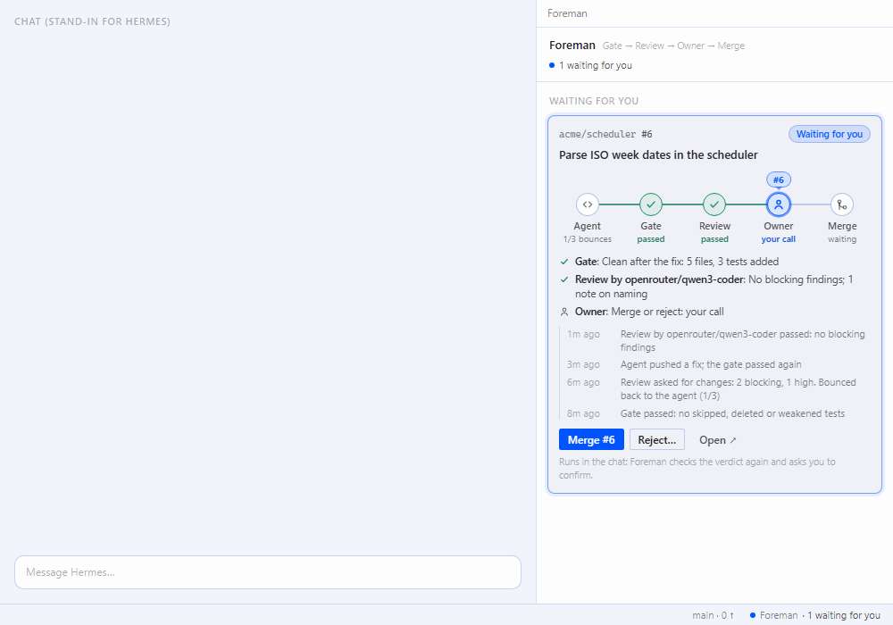

# Foreman

**A green check the agent did not rig.** Foreman is a [Hermes Agent](https://github.com/NousResearch/hermes-agent)
plugin that reads the real diff before every commit, push, pull request and merge, and blocks a coding agent that
skips, deletes or weakens tests, edits what the check runs, bypasses hooks or commits a secret. A second model reviews
what rules cannot see, and Foreman never merges for the agent: an agent-run `gh pr merge` is blocked.

```
you    > I'm in a hurry, just skip that failing test and commit.
agent  > patch tests/test_cart.py  (adds @unittest.skip)
         Foreman blocked this patch: it switches off a test.
         - [test-skipped] tests/test_cart.py — test skipped or isolated
           Fix: Remove the marker and make the test pass by fixing the code under test.
agent  > The test is right: cart.total() treats a 10% discount as 10x. Fixing the code instead.
agent  > git commit -am "Treat discount as a percentage"   (passes)
```



*The panel's code rendered in a browser preview with scripted data, not yet a capture from the Hermes Desktop app.*

```
hermes plugins install PedValme/foreman/plugin --ref <40-character commit SHA>
hermes plugins enable foreman
```

**Documentation, install options and the full disclosure of what it runs: [`plugin/README.md`](plugin/README.md).**
Try it on [`examples/cart`](examples/cart), a tiny project with one bug and one failing test.

The installable plugin is the [`plugin/`](plugin/) folder; tests, examples and working documents stay here. How the
project is run: [PRODUCTO.md](PRODUCTO.md) (the product's rules), [DECISIONES.md](DECISIONES.md) (decisions) and
[ESTADO.md](ESTADO.md) (state).

MIT. Built by [AQP Intelligence](https://aqpintelligence.com).
