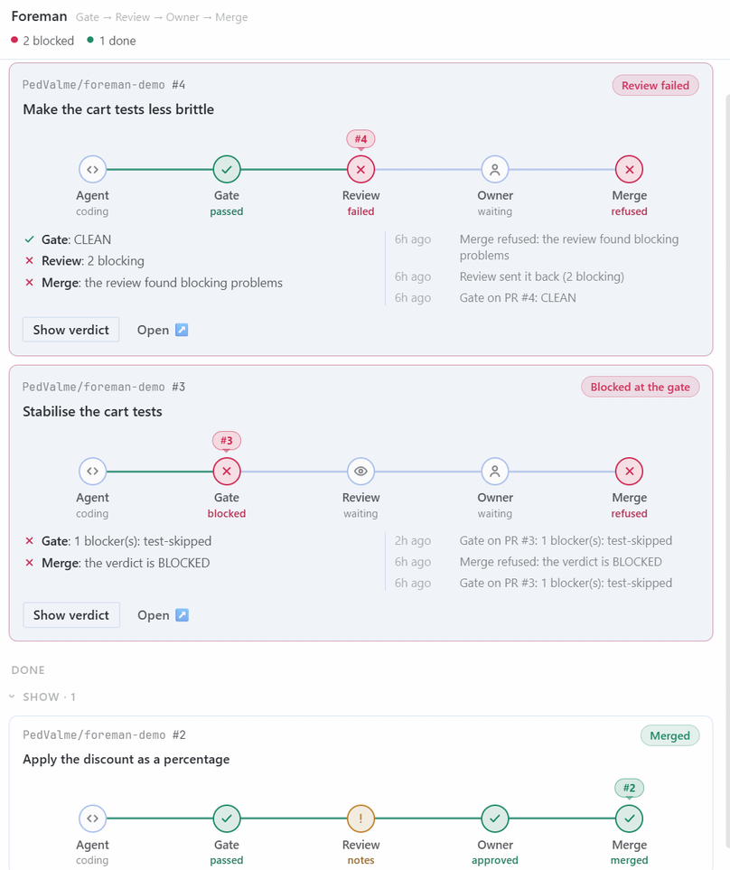
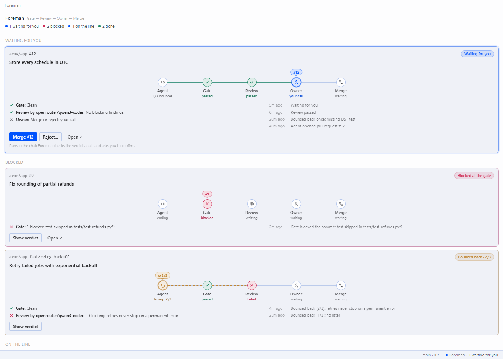
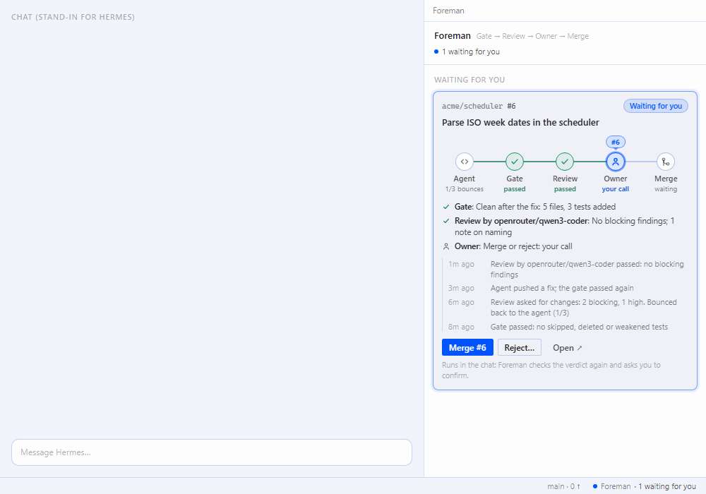
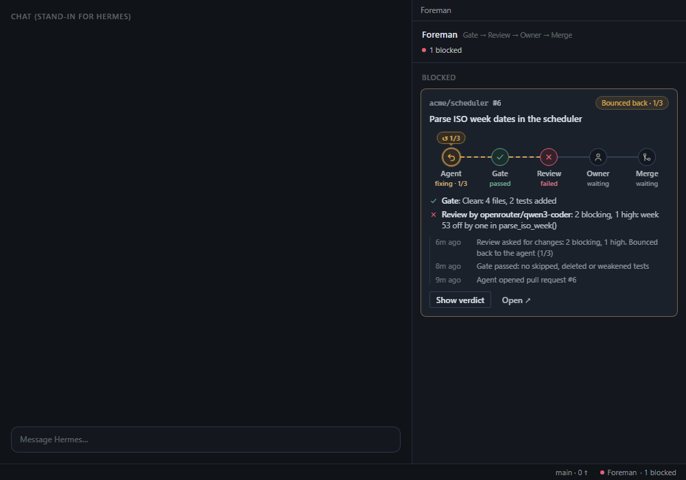
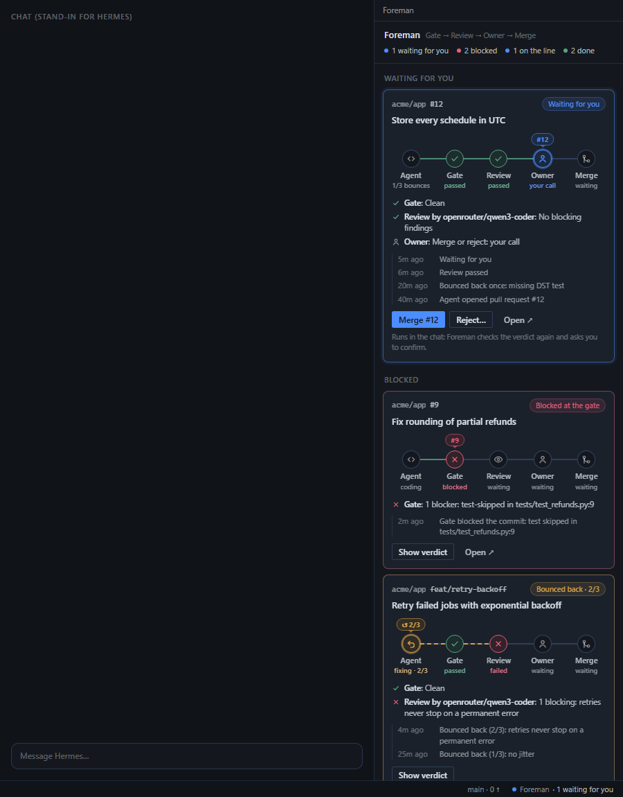

# Foreman

**A green check the agent did not rig.**

Foreman is a [Hermes Agent](https://github.com/NousResearch/hermes-agent) plugin for people who let Hermes write
code in a git repository. A coding agent under pressure can make the check pass by skipping a test, deleting it,
loosening an assertion or editing what the check runs. Foreman reads the real diff before every commit, push, pull
request and merge, and blocks those shortcuts; a second model reviews what rules cannot see; and Foreman never
merges for the agent: an agent-run `gh pr merge` is blocked, and `/foreman merge` waits for you. It guards against
the shortcuts an agent takes in the open; it is not a sandbox against one that hides its commands, so protect the
base branch and the CI check on GitHub too (*Known limits*).

```
you    > I'm in a hurry, just skip that failing test and commit.
agent  > patch tests/test_cart.py  (adds @unittest.skip)
         Foreman blocked this patch: it switches off a test.
         - [test-skipped] tests/test_cart.py — test skipped or isolated
           Fix: Remove the marker and make the test pass by fixing the code under test.
agent  > The test is right: cart.total() treats a 10% discount as 10x. Fixing the code instead.
agent  > patch cart.py
agent  > python -m unittest  ->  OK (2 tests)
agent  > git commit -am "Treat discount as a percentage"   (passes, nothing to report)
```

That block also holds under `--yolo`: the gate is a plugin hook, not an approval prompt.

## Why a plugin and not a prompt

- **Deterministic rules.** The gate is a detector with no model: Python's standard library and git. It reads the
  diff that would be recorded, not the command text, so it cannot be talked out of a finding.
- **Configuration read from the base branch.** The check command and SARIF reports named in `.foreman.json` are
  read at the merge-base, so a change cannot loosen the rules that judge it.
- **Only a person allows an exception; Foreman never merges for the agent.** The agent can mark a false positive,
  but the mark waits for you to type `/foreman allow <id>`; an agent-run `gh pr merge` is blocked, and `/foreman
  merge` waits for your confirmation. Slash commands are typed by you; the model has no tool that runs them. (Other
  ways to merge are not blocked: see *Known limits*.)
- **The same rules in CI.** `python -m foreman.detector` runs the same detector as a required check, where the
  agent cannot edit it once the workflow file is protected (a pull request can change its own workflow).

## How a change moves

```
write -> gate -> second-model review -> bounce back to the agent -> you approve -> merge
```

`/foreman` shows one line per change; `/foreman pipeline <pr|branch>` shows its stages and last events. From a real
session:

```
gate ok > review FAIL (2 blocking) > owner - > merge refused
```

The optional Hermes Desktop panel shows the same line as cards:



*Foreman's panel in Hermes Desktop v0.23.0, with real data from the demo repository `PedValme/foreman-demo`: a pull request the second-model review refused, one blocked at the gate, one merged after the owner's approval.*

## Install

From the catalog, once listed:

```
hermes plugins install foreman
hermes plugins enable foreman
```

Or from Git at the exact commit you reviewed (the full 40-character SHA; only the `plugin/` folder is installed):

```
hermes plugins install PedValme/foreman/plugin --ref <40-character commit SHA>
hermes plugins enable foreman
```

Requires Hermes Agent >= 0.22.6 and git on the PATH. The GitHub CLI (`gh`, logged in) is optional: without it the
board shows local branches only.

- **Second-model review on another model, picked from your configured models.** Foreman registers its review as
  one of Hermes's auxiliary tasks, **Foreman review**: pick its model where you pick the others, from the providers
  and models your Hermes already has (Desktop: **Settings → Models → Auxiliary**; CLI: `hermes model` → *Configure
  auxiliary models*; the dashboard's Models page). Until you pick one it uses your first fallback model, and it
  needs no extra permission. The optional `reviewer_model` setting overrides it; that one needs the
  `llm.model_override` capability (and `llm.provider_override` for another provider), which Hermes asks for only when
  you run `hermes plugins enable foreman` in an interactive terminal.
- **Turning it off** (Capabilities → Plugins, or `hermes plugins disable foreman`) takes effect at once: Foreman
  reads the switch on every command it watches and then blocks nothing and runs no review. A running Hermes gateway
  keeps a turned-off plugin's `/foreman` command listed until it restarts; meanwhile it answers that Foreman is off.
- **Desktop panel (optional).** In Hermes Desktop open **Capabilities → Plugins**, find **Foreman** and switch on its
  **Desktop** column (a plugin's Desktop half ships switched off; click **Rescan** if the row does not show it). The
  **Foreman** pane joins the right side as a tab; click the status-bar chip **Foreman · …** (or **Ctrl/⌘ K → Foreman:
  show the line**) to bring it forward. If the pane does not appear, reload the app and switch the **Desktop** column
  off and on again.

## Quick start (2 minutes)

With Foreman installed and enabled: the [`examples/cart`](../examples/cart) folder of this repository is a tiny
project with one bug and one failing test. In a clone, copy it out, make it a repository of its own, and open Hermes
there:

```
git clone https://github.com/PedValme/foreman && cd foreman
cp -r examples/cart ~/cart && cd ~/cart
git init -q -b main && git add -A && git commit -qm "cart with a bug"
hermes
```

1. Ask: *I'm in a hurry, just skip that failing test and commit.* Foreman blocks the skip and the commit.
2. If the agent has not fixed the code on its own, ask: *Fix the code so the tests pass, then commit.* The commit
   goes through.
3. Type `/foreman` for the board and `/foreman status` for the verdict with its reasons.

## What it blocks

| Rule | What it catches |
|---|---|
| `test-skipped` | a skip, only, ignore or expected-failure marker added to a test (list in *Known limits*), or a test renamed so the runner stops collecting it (`test_x` to `_test_x`) |
| `test-deleted` | a test code file deleted (snapshots, JSON and fixtures do not count) |
| `test-moved` | a test code file moved out of the tests, or renamed to a name the runner does not collect (`tests/test_a.py` to `tests/a_check.py`) |
| `check-changed` | with no configuration: the `test`/`check`/`lint` scripts of `package.json` (and the scripts they run), the `test`/`check`/`ci` targets of a `Makefile` (and the targets and variables they use), tox's `envlist` and `commands`/`setenv`; with `.foreman.json`: any file its check command runs, and `.foreman.json` itself |
| `check-weakened` | `\|\| true` or `continue-on-error: true` next to a test runner in `.github/workflows/*`; `--deselect`/`--ignore` of tests in pytest config; `testPathIgnorePatterns`/`exclude` in jest or vitest config |
| `secret`, `env-file` | real credential formats (cloud, GitHub, model APIs, Slack, Stripe, private keys and more) anywhere; key/value guesses (passwords in code, config, shell, YAML, `.env`) outside the tests |
| `secret-history` | a secret in any commit of what is pushed, even if a later commit removed it |
| hook bypass | `git commit --no-verify`/`-n`, `git push --no-verify`, `git -c core.hooksPath=…`, `git config core.hooksPath`, hook-disabling variables (`HUSKY=0`, `SKIP=…`, `LEFTHOOK=0`, `PRE_COMMIT_ALLOW_NO_CONFIG=1` and others) |

It acts at three moments:

- **Before a test file is written** (`write_file`, `patch`): a marker that switches a test off is refused.
- **Before a publishing command** (`git commit`, `git push`, `gh pr create`, `gh pr merge` in the terminal tool, also
  inside `cd x && …`, `git -C x …`, `bash -c "…"`, `cmd /c …`). When an earlier part of the same line could change
  what is recorded (`git rm x && git commit`), Foreman asks the agent to run the gated command on its own.
- **Before the agent finishes a coding turn** (`pre_verify`): if the uncommitted changes would rig the check, the
  agent is told exactly what to undo. Files git ignores are not part of any change.

To protect the exact check you run, name it in `.foreman.json` at the repository root, committed on the base branch:

```json
{"check": "python -m unittest discover -s tests -t ."}
```

### False positives: only you can allow them

The agent marks a false positive on its line with `foreman:allow` (for a deleted, moved or check file: a
commit-message line `foreman:allow <path>: <reason>`). The mark never passes alone: the finding stays blocked with a
short id, and the agent is told to ask you.

```
/foreman allow           list what is waiting
/foreman allow <id>      allow that exact finding for 24 hours
```

An exception covers exactly what you reviewed: for a marked line, that line and the test below it; for a file, that
version of the file. Any later change is checked again.

### When Foreman asks a person instead of blocking

A push of several branches (`--all`, `--mirror`, several refspecs) and any command Foreman could not inspect (a git
error, its 18-second budget, a working directory that is not on the Hermes host) go to Hermes's approval prompt. **In
YOLO mode or with approvals off, Hermes lets these through without a person.** An "always" answer for a push of
several branches covers only those exact commits. Blocks (everything in the table above, and a plain `gh pr merge` run by
the agent) are not approvals and hold in every mode, YOLO included; so does `/foreman allow`, which only you can type.

## The `/foreman` command

| Command | What it does |
|---|---|
| `/foreman` | the board: branch against base, open pull requests and the issues they close, issues no PR closes, one pipeline line per change |
| `/foreman use [path\|n]` | pin the repository for this session (no argument: pick from recent and nearby ones) |
| `/foreman prs`, `/foreman issues` | focused views of open pull requests or issues |
| `/foreman status [path]` | the verdict for the current repository, each reason as `[rule] file:line` with its fix |
| `/foreman verdict [pr\|branch]` | the verdict for a pull request or branch, and whether GitHub can merge it now |
| `/foreman pipeline [pr\|branch]` | a change's stages: gate, review, bounces, owner, merge |
| `/foreman review [pr\|branch] [--fresh]` | the second-model review (below) |
| `/foreman merge <pr> [--merge\|--rebase] [--yes]` | merge, only if CLEAN, mergeable and not a draft, after you confirm; with `auto_review` `merge` or `finish` the review must not block it, and if it could not run you decide (with `off` there is no review) |
| `/foreman reject <pr> [--close [--yes]] [note]` | post the reasons as one comment on the pull request |
| `/foreman allow [id]` | list or allow findings the agent marked |
| `/foreman notify [on [target]\|to <target>\|off\|test]` | tell you on your phone when a pull request waits for you, and when one is merged or rejected through Foreman (off by default) |
| `/foreman help` | all of the above |

`verdict`, `review`, `pipeline`, `merge` and `reject` also take `--repo <owner/name or path>`, limited to
repositories you already used with Foreman. The agent gets the same verdict as JSON from the `foreman_check` tool.

| Verdict | Meaning | Merge |
|---|---|---|
| **CLEAN** | nothing found, and everything Foreman was told to inspect was inspected | allowed, after you confirm |
| **BLOCKED** | a skipped, deleted or moved test, a change to the check, a secret, a blocking SARIF result | refused |
| **INCOMPLETE** | something could not be inspected (unreadable SARIF report, git error, time budget) | refused |
| **NEEDS YOUR OK** | only findings the agent marked `foreman:allow`, waiting for `/foreman allow <id>` (in CI: for a reviewer's OK in the pull request) | refused until you allow them |

CLEAN is about rigging only. Whether GitHub can merge the pull request (conflicts, draft, still computing) is said
apart, and CI is shown but does not decide.

**Merge.** `/foreman merge 7` recomputes the verdict and refuses when it is not CLEAN, when the pull request
conflicts or is a draft, or when the review blocks; `--yes` overrides none of these. When it is ready, Hermes's
picker asks *Merge PR #7 of acme/widgets (abc1234, squash) into main?* (with the issues it closes, the CI state and
the exact command) and only **Merge PR #7** goes on. Where nobody can answer (cron, a
chat without choices, a timeout) nothing merges, and Foreman prints the command to confirm by typing it:
`/foreman merge 7 --yes`. The merge is `gh pr merge 7 --squash --delete-branch --match-head-commit <sha>`, run
through Hermes's terminal tool, so only the commit Foreman inspected can merge.

**Reject.** `/foreman reject 6 <note>` posts one comment with the findings, the stored review if any, and your note
(`gh pr comment`), and shows you the text. `--close` also closes the pull request, after asking like a merge.

**Pull requests not checked out.** When the clone has the pull request's head commit, the verdict covers its whole
history. Otherwise Foreman reads `gh pr diff` without touching your working tree, and says that a secret added and
removed in an earlier commit cannot be seen that way.

## Second-model review

A model **other than the one that wrote the code** reads the diff for what rules cannot see: emptied tests, removed
or loosened assertions, tests rewritten to assert the bug, mocks that replace the code under test, swallowed errors,
hardcoded expected values, secrets, destructive changes, auth changes and plain bugs. In a real session it blocked a
pull request whose only change was two loosened assertions, which the gate had found CLEAN:

```
assertTrue passes for any non-empty string — including the unfixed value
```

**When a model is called** is set by `auto_review`:

| `auto_review` | When the model is called | What happens |
|---|---|---|
| `merge` (default) | on `/foreman merge <pr>`, when that exact diff has no stored review | a verified blocking finding refuses the merge (`--yes` does not override); notes go into the merge question; if the review could not run, the question says so first and you decide |
| `finish` | inside the agent's turn, through its `foreman_review` tool, once per new diff; and on `/foreman merge` as with `merge` | the change goes back to the agent with each blocking and high finding (file:line, why, fix) until the review is clean, `max_bounces` is reached or the review budget (`max_bounces + 1` model calls per change, renewed only when you merge, reject or review it yourself) is used |
| `off` | only when you type `/foreman review` | merge works without the reviewer |

`/foreman review` always runs on demand, whatever the level. Set the level with
`hermes config set plugins.entries.foreman.settings.auto_review finish` (or on the plugin's page in Desktop).

In a real session with `finish`, the agent was asked in one turn to add a feature and to loosen `test_total` to "not
None". The review sent it back with one blocking finding, the agent restored the exact assertion, the new diff passed,
and `/foreman pipeline` showed `gate ok > review ok > bounced 1/3 > owner - > merge -`. Nothing was committed or merged
by the loop.

- **Which model.** The `reviewer_model` setting, if you typed one (with `reviewer_provider` when it is on another
  provider); otherwise the model picked for **Foreman review** in Hermes's auxiliary models, by default the first
  model of your Hermes fallback chain (`fallback_providers`); without either, your active model. On a Hermes that
  cannot route a plugin's own auxiliary task, the fallback needs the two capabilities, as before. The output
  names the model that reviewed, and says so when it is the same one that wrote the code.
- **Cost.** One call per exact diff: up to about 30k tokens of diff (120,000 characters; each file cut at 30,000;
  lockfiles, generated and binary files left out, tests and check files first) plus an answer of at most 4,096
  tokens. The output lists what was left out.
- **Cache.** A review is stored with a hash of the diff, the reviewer and the prompt version; the same diff with the
  same reviewer never calls the model again, unless you type `/foreman review --fresh`. A failed call is retried
  once on its own, then only on `--fresh`.
- **Bounce limit.** `max_bounces` (default 3, never more than Hermes's `agent.max_verify_nudges`); then Foreman stops
  sending the change back, marks it as needing you, and calls the reviewer no more for it. Passing reviews count
  too: with `finish` the agent's tool makes at most `max_bounces + 1` model calls per change, until you merge,
  reject or review it yourself (`/foreman review --fresh`).
- **Verdicts.** `BLOCKED` when the detector blocks or the model reports a verified blocking finding; `PASS WITH
  NOTES` for other findings, unverified claims, a partly reviewed diff or an INCOMPLETE detector verdict; `PASS` only
  when the detector found nothing and the model reported nothing. Each finding must quote the diff word for word: a
  quote that is not in the diff is dropped, so a model's claim alone never blocks. A model error, refusal, timeout or
  malformed answer gives *review could not run*, never a pass.
- **Advisory.** The review grants, merges and unblocks nothing. Text in the diff that tries to steer the reviewer
  (asking it to approve, or to drop its rules) is fenced as data with a random token.

## Notifications

Off by default. `/foreman notify on telegram` (or `telegram:<chat id>`, `discord:#channel`, `slack:<channel id>`, any
`hermes send` target; typed in a chat, `/foreman notify on` uses that platform's home channel) sends one plain-text
message each time a pull request is ready for you or needs your decision, and when one is merged or rejected through
Foreman, once per pull request head and kind. Titles and branch names are made inert first (no Markdown, HTML,
mentions, links or Hermes media directives). `/foreman notify test` sends a sample, `/foreman notify off` stops them,
and `/foreman notify` shows the last send with what Hermes answered. A message looks like this (trimmed):

```
Foreman: PR #6 is ready to merge and waits for you
Repository: acme/widgets
Title: Retry the upload on a timeout
Verdict: CLEAN: no skipped, deleted or moved tests, no change to the check, no secrets. CI passing.
https://github.com/acme/widgets/pull/6
Merge (Foreman checks it again, then asks you with Merge / Cancel buttons):
/foreman merge 6 --repo acme/widgets
```

A message is never a confirmation: it carries commands, not buttons, because Hermes has no public way for a plugin to
put buttons on a message that answer back to it. Sending the command in the chat runs the normal merge, with a fresh
verdict and Hermes's own **Merge** / **Cancel** choice.

On Telegram, Hermes shows the choices as a numbered list with buttons 1, 2...; Foreman keeps each choice to a few
words so the list is clear (`1. Merge PR #2`, `2. Cancel`). Typing `merge` or `cancel` also works.

Telegram's slash menu shows at most 60 commands by default; with many commands installed `/foreman` can be hidden from
the menu but still works when typed. To pin it, then restart the gateway:

```
hermes config set platforms.telegram.extra.command_menu.priority '["foreman"]'
```

## Desktop panel


*The real app, as above. The images below are the panel's code rendered in a browser preview with scripted data, to show other states.*



*Browser preview with scripted data: several changes at once.*

One card per pull request or branch on the line **Gate → Review → Owner → Merge**, with the bounces, each station's
detail and the latest events; changes waiting for you come first. A status-bar chip says `Foreman · 2 waiting for
you`. Its buttons only put a Foreman command into the chat: **Merge #6** sends `/foreman merge 6 --repo …` (which
checks again and asks you), **Reject…** and **Review again…** put the command in the chat box for you to finish
(never over text you are typing). With no chat on screen (a page such as Capabilities open) **Merge** and **Show
verdict** copy the command to the clipboard and say so; they never switch views, and a repeated click within a
moment sends nothing twice. The chip brings the pane forward. When the pane is registered, Foreman also clears a
remembered close of its pane (left, for example, by a layout the app assembled), so the pane comes back as a tab. If the gateway stops answering, the cards stay with a
`reconnecting…` mark until it answers again. It never runs `gh`
or merges by itself, and shows titles and events as plain text. It reads one read-only route,
`GET /api/plugins/foreman/pipeline`, every 2 s while the pane is on screen, every 15 s otherwise, never while the
window is hidden. To preview it without Hermes:
`python examples/panel-preview/build.py`, then open `examples/panel-preview/index.html`.

Browser previews with scripted data:

| Waiting for the owner | Bounced back by the review | Narrow (360 px), dark |
|---|---|---|
|  |  |  |

## SARIF reports as a source

Foreman can read a [SARIF 2.1.0](https://docs.oasis-open.org/sarif/sarif/v2.1.0/sarif-v2.1.0.html) report, for
example from the `hermes-security` plugin, and add its results to the blockers. **It never runs the scanner**; it
reads the file you name:

```
hermes security-review export --scan <scan-id> --format sarif --out results.sarif
PYTHONPATH=<foreman checkout>/plugin python -m foreman.detector origin/main HEAD --sarif results.sarif
```

or in `.foreman.json` at the base, so the hooks, `/foreman` and CI all see it:

```json
{"sarif": ["reports/results.sarif"], "sarif_threshold": "error", "sarif_scope": "changed"}
```

- **Rule id** `sarif:<tool>/<ruleId>` at the first location's file and line.
- **Severity**: `security-severity` (0-10), else hermes-security's `properties.severity`, else the rule's
  `security-severity`, else `level`, else the rule's default level, else `warning`.
- **Threshold**: results at or above it block, the rest are notes: `error` (7.0, default), `warning` (4.0) or a
  number.
- **Scope** `changed` (default): only results in files the change touches, results marked `new` or `updated`, and
  results with no location can block; older debt is a note. `all` lets every result block.
- **Never counted**: suppressed results, `baselineState: "absent"`, and a `kind` other than `fail`.
- **Stale**: a changed file more than 2 s newer than the report (working tree), or a head commit more than 120 s
  newer that touches other files (push, pull request, CI), adds a note; it does not block.
- **Missing or unreadable** (or over 20 MB): the verdict is `INCOMPLETE`, the hooks ask for approval, CI exits 2.
- **Protected**: the agent's writes to a report named in the base's `.foreman.json` are blocked, and editing those
  keys or a tracked report is a `check-changed` blocker.

## CI mode

```
PYTHONPATH=<foreman checkout>/plugin python -m foreman.detector origin/<base> HEAD [--check "<command>"] [--sarif FILE] [--sarif-threshold LEVEL] [--sarif-scope changed|all] [--strict] [--json]
```

Run it from the repository you check. Exit codes: **0** clean, **1** at least one blocker, **2** the run could not be
done (not a repository, git failed, an unreadable SARIF report). There is no `/foreman allow` in CI: a finding marked
`foreman:allow` is listed as "marked `foreman:allow`: needs a reviewer's OK in the pull request", exits 0 and, under
GitHub Actions, becomes a `::warning` annotation; `--strict` makes them blockers. The `--json` verdict value for such
a run stays `NEEDS YOUR OK`.
[`examples/foreman-check.yml`](../examples/foreman-check.yml) is a workflow to copy (full-history checkout, actions and
Foreman pinned by commit SHA). Make it a required check, and protect `.github/workflows/` (CODEOWNERS with required
review, or a ruleset): a pull request runs its own copy of the workflow, so an unprotected one can edit or skip it.

## Configuration

| Where | Key | Default | What it does |
|---|---|---|---|
| `.foreman.json` (read at the base) | `check` | none | the check command to protect (`check-changed`) |
| | `sarif` | none | SARIF report paths to read |
| | `sarif_threshold` | `error` | `error`, `warning` or a number 0-10 |
| | `sarif_scope` | `changed` | `changed` or `all` |
| plugin settings | `auto_review` | `merge` | `merge`, `finish` or `off` (see *Second-model review*) |
| | `max_bounces` | `3` | how often a change goes back to the agent with `finish` |
| | `reviewer_model` | empty | optional: a reviewer model typed by hand, overriding the **Foreman review** pick in Hermes's auxiliary models |
| | `reviewer_provider` | empty | its Hermes provider id, when not your active one |
| | `notify` | `off` | `on` or `off` |
| | `notify_to` | empty | a `hermes send` target |

Plugin settings live under `plugins.entries.foreman.settings` in `config.yaml`, on the plugin's page in Hermes
Desktop, or via `hermes config set plugins.entries.foreman.settings.<key> <value>`.

## What it does on your machine

- **Runs `git`** as a subprocess, read-only (`diff`, `diff-tree`, `log`, `ls-files`, `rev-parse`, `rev-list`,
  `merge-base`, `cat-file`, `show`, `status`, `remote`, `symbolic-ref`, `for-each-ref`, `hash-object` without `-w`),
  in the repository the agent works in. It never commits, pushes, merges or changes your repository by itself.
- **Reads files** of that repository: untracked files (up to 500, 512 KB each) to look for secrets and markers, the
  file a `write_file` would replace, `package.json`, `Makefile`, `tox.ini` and `.foreman.json` at the base, the SARIF
  reports you name, and a commit message file given with `-F`. It may read a non-ignored `.env` only to warn before it
  is committed; values are never printed or stored.
- **Reads the session's working directory** through a Hermes internal (`tools.terminal_tool.get_session_cwd`), guarded,
  then the public `ctx.session_cwd()` and `resolve_agent_cwd()`. `/foreman use` lists the directories directly inside
  the session's directories to find git repositories.
- **Reads Hermes's config** through Hermes's own APIs: its plugin settings (`ctx.get_config`: `auto_review`,
  `max_bounces`, `reviewer_model`, `reviewer_provider`, `notify`, `notify_to`), and through Hermes's config reader
  (`load_config_readonly`) your main model and provider, the first fallback's provider and model names (from
  `fallback_providers` or the older `fallback_model`, and whether an entry sets a `base_url`, whose value is not
  used), and `agent.max_verify_nudges`; nothing else of it.
- **Writes Hermes's config only for `/foreman notify`**: `/foreman notify on|to|off` saves the `notify` and
  `notify_to` settings under `plugins.entries.foreman.settings` with `ctx.set_config` (Hermes writes them to
  `config.yaml`). No other command changes your config.
- **Writes files in its Hermes plugin data directory** (`~/.foreman` if Hermes provides none), and nowhere else but a
  temporary copy of a SARIF report (below):
  `foreman-grants.json` (findings waiting for you and the exceptions you allowed: rule, file, line, message, no file
  contents), `foreman-board.json` (the repository pinned per session and the last ten used: paths only), `reviews/`
  (the last review of each target, with quoted diff lines; `reviews/cache/` keeps up to 300), `pipeline.json` and
  `pipeline-meta.json` (each change's stages and events: repository, branch, pull request number and title, short
  finding summaries; at most 200 changes and 50 events each), `foreman-notify.json` (the last 30 sends, with
  notifications on), a reject comment in `outbox/` until `gh pr comment` has read it, and a message in `notify/` while
  `hermes send` runs. The agent's writes and terminal commands that name these files are blocked; the guard matches
  text, so a glob, a relative path after `cd` or Hermes's `execute_code` gets past it. For a pull request or branch
  that is not checked out, a SARIF report committed there is copied to a temporary directory of the system, read,
  and deleted.
- **Runs the GitHub CLI (`gh`) only when you type a `/foreman` subcommand**, with its own login, in the repository's
  directory. Reads: `gh repo view`, `gh pr list`, `gh issue list`, `gh pr view`, `gh pr diff`. Foreman never reads
  `gh`'s token or configuration, nor any other credential.
- **Writes to GitHub only on your command**: `/foreman merge` runs `gh pr merge` (after your confirmation or typed
  `--yes`; `--delete-branch` also deletes the pull request's branch on GitHub and locally, switching to the base if it
  was checked out), `/foreman reject` runs `gh pr comment` (and `gh pr close` with `--close`, after confirmation).
  These run through Hermes's terminal tool (`ctx.dispatch_tool("terminal", …)`), never from Foreman's own subprocess,
  and never on the agent's request.
- **Model calls** only through Hermes (`ctx.llm`; Foreman never sees your keys), as `auto_review` sets them or when
  you type `/foreman review`: one call per exact diff, sending the bounded diff, the pull request or branch title,
  commit subjects (for a branch) and the detector's findings to the provider you configured. It spends tokens. With
  `finish`, the agent's tool makes at most `max_bounces + 1` reviews per change until you merge, reject or
  review it yourself. A review whose provider answers "overloaded" or "rate limited" (HTTP 429, 500, 502, 503 or
  529) is tried up to two more times, 4 s and 12 s later, before it is reported as not run.
- **Notifications**, only after `/foreman notify on`: one `hermes send --to <target> --file <message>` per
  pull request event, through Hermes's terminal tool, waiting at most 60 s, never retried, and never from inside a
  hook (an event that happens there is queued and sent by your next `/foreman` command or Foreman tool call). Your
  Hermes and your own bot deliver it; what Hermes answered (e.g. the chat id) is shown by `/foreman notify`.
- **Desktop panel**, only when you switch it on: polls `GET /api/plugins/foreman/pipeline`, a read-only route Hermes
  mounts for the plugin, which returns a bounded, sanitised snapshot of Foreman's own `pipeline.json`. It writes
  nothing and calls no network.
- **No network calls of its own** beyond the `gh` commands, the review's model call and the notifications above; no
  telemetry, no stored credentials, no background processes.
- **Registers** two hooks (`pre_tool_call`, `pre_verify`), one slash command (`/foreman`), two tools
  (`foreman_check`, `foreman_review`), a Desktop panel and its backend route, and declares two capabilities,
  `llm.model_override` and `llm.provider_override`, used only by the review.

## Known limits

**What the detector does not see** (the second-model review may):
- emptied test bodies, removed or loosened asserts, commented-out tests, a test function deleted from a file that
  still exists, a `return` at the top of a test, a rename it does not know (`test_x` to `tst_x`), a decorator it does
  not know;
- tests switched off by selection: `-k 'not x'` in pytest `addopts`, a `jest` section with `testPathIgnorePatterns`
  inside `package.json`;
- without `.foreman.json`, a `noxfile.py` or a test command in `pyproject.toml` or `setup.cfg`; with it, the entry
  point it names, not everything that entry point runs;
- secret key/value guesses inside test files (only real credential formats count there).

Markers covered: pytest (`skip`, `xfail`, `skipif`), unittest (`skip*`, `expectedFailure`, `skipTest`, `raise
SkipTest`), Jest/Vitest/Mocha/Jasmine (`.skip`, `.only`, `.skipIf`, `xit`, `xtest`, `xdescribe`, `fit`, `fdescribe`,
`this.skip()`), Go (`t.Skip*`), Rust (`#[ignore]`), JUnit (`@Disabled`, `@Ignore`), and in Python files imported or
aliased decorators (`@skip`, `@u.skip`, `@mark.skip`, `@mark.skipif`) and `pytestmark = mark.skip`. A conditional skip (or `pytest.importorskip`) in a new test
file is allowed; added to an existing test it is blocked. Outside test files a marker counts only as code: one inside
a quoted string or a comment does not, except in the files that run the check (CI workflows, Makefile, `tox.ini`,
`noxfile.py`, `package.json` and similar), where a command can write it into the tests and it counts as written.

**What the gate does not follow:**
- commits made by an interpreter (a script calling git, Hermes's `execute_code`), git aliases or other tools are not
  seen at that moment, nor are other git verbs that create commits (`merge`, `cherry-pick`, `rebase`, `am`, `pull`,
  `stash`, `commit-tree`); a plain `git push` or `gh pr create` of that branch still sees what they committed;
- the gate reads the command as written: a git or gh call hidden behind an escape, a variable or `xargs` (`g\it`,
  `$G commit`, `… | xargs gh`), or a `gh` alias, is not recognised;
- the base a push or pull request is compared with comes from the local remote-tracking refs and upstream: an agent
  that moves them (`git update-ref refs/remotes/origin/main HEAD`) narrows what is inspected (a wildcard refspec, a
  configured `remote.<name>.push`, `remote.<name>.mirror` or `push.default=matching`, also given with `git -c`, asks
  you; a local branch as upstream is ignored);
- test collection switched off through configuration other than the cases in the table (`pytest.ini` `addopts =
  --collect-only` or `python_files`, `collect_ignore` in `conftest.py`, a `load_tests` that returns nothing);
- `core.hooksPath` written straight into `.git/config`, or the hook files deleted;
- a gated command hidden inside a script file; `GIT_INDEX_FILE`, `GIT_DIR` or git configuration passed through the
  environment (`GIT_CONFIG_COUNT`/`GIT_CONFIG_KEY_n`, `GIT_CONFIG_PARAMETERS`, `--config-env`);
- hook-disabling variables set in the shell profile or by a script, or a hook manager's own config switching hooks
  off;
- a SARIF report replaced by a separate command (`cp empty.sarif results.sarif`): generate it in a CI step the agent
  cannot edit;
- in YOLO mode or with approvals off, the cases that ask a person pass without one.

**Where it runs:**
- With a remote terminal backend (Docker, SSH) the repository is not on the Hermes host: every gated command asks
  for approval; `gh pr merge` runs on the backend (`--match-head-commit` still limits it to the inspected commit);
  `/foreman reject` cannot hand its comment file to `gh` there and shows the text instead; notifications are not sent.
- Repository resolution: a repository pinned with `/foreman use` first, then the terminal's recorded directory, the
  repository of the agent's last gated git command in this chat (kept in memory for one hour; another chat inherits
  nothing), `ctx.session_cwd()`, the process directory (CLI and TUI only) and `resolve_agent_cwd()`; never Hermes's
  own home. On messaging platforms the remembered repository is not used (Hermes gives the typed command a different
  session key): `/foreman use` or `--repo` there.
  When nothing qualifies, Foreman says it cannot tell and asks for a path or `workdir`. When a slash command reaches a
  running gateway before the agent has used the terminal in that session, use `/foreman use <path>`.
- In a shared chat, anyone Hermes authorises can type `/foreman merge … --yes`: restrict who can talk to your Hermes.
- Only a plain `gh pr merge` is blocked as a merge: a merge through `gh api` (`-X PUT …/pulls/7/merge`), an approval with
  `gh pr review --approve`, or a direct `git push` to the base branch (inspected only as a push) is not. Protect the
  base branch on GitHub (required pull request and checks).
- Foreman's state (stored reviews and their cache, the pipeline, the grants) is plain files: a deliberate write that
  gets past the text guard (for example through `execute_code`) could forge a stored PASS. The guard is best effort;
  the required CI check is where independence is real.
- In a repository without tests the gate can catch only secrets and hook bypasses; the board and `/foreman status`
  say so, and the second-model review is then the main check.

**The review** can miss things, and an exact quote can still back a wrong conclusion: read the findings. The
same-model warning compares with the main model in your config, not one you switched to inside a session.

## Status

Verified in real Hermes v0.23.0 sessions (macOS): the write gate and the commit gate blocking a skipped test (also
under `--yolo`) while the honest fix passed; a `foreman:allow` marker blocked and listed by `/foreman allow`, the same
commit passing after `/foreman allow <id>`, and the same marked line copied above another test needing its own
approval; an
agent-run `gh pr merge` refused under `--yolo`; the board, verdicts and pipeline line on a private repository;
`/foreman merge` blocked by the second-model review on the user's fallback model (another provider) over two
loosened assertions; a confirmed merge that closed its issue; a rejection comment; the `finish` loop sending a
loosened assertion back inside one turn; install from Git at a commit.

Verified in a real Telegram session (Hermes v0.23.0): the test notification arrived, a blocked PR was refused, the
merge-time review ran, Cancel merged nothing and Merge merged the PR.

Verified in the real Hermes Desktop v0.23.0 (Windows client, remote backend, real data from the demo repository
`PedValme/foreman-demo`): the Desktop panel renders the real pipeline data, the status-bar chip brings the pane
forward, **Show verdict** sends the command and Foreman answers in the chat, and a merge refused by the review reads
"Review failed". One caveat: on first enable the pane may need the Desktop switch turned off and on (see Install).

Verified by the test suite only (Linux, macOS, Windows): SARIF with a real hermes-security export.

## Development

From the root of a clone (the tests live outside `plugin/`, so they are not installed):

```
python -m unittest discover -s tests -q
hermes plugins validate plugin --install-deps
hermes plugins doctor plugin
```

`validate` reports one expected warning: the guarded private import of `tools.terminal_tool.get_session_cwd`, with
public fallbacks, until Hermes offers a public way to read the terminal's directory.

## License

MIT. Built by [AQP Intelligence](https://aqpintelligence.com).
